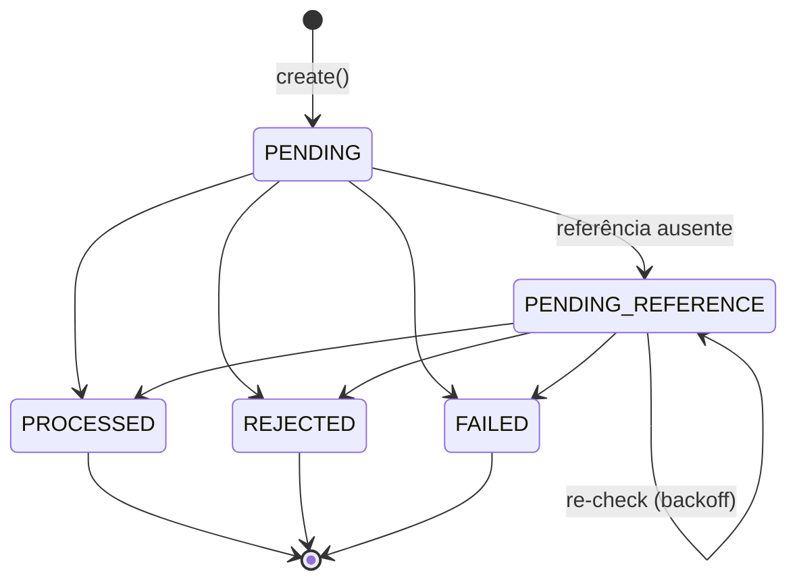

# Arquitetura — Distributed Wagering Processor

Este documento registra **as decisões, as justificativas, os trade-offs e as limitações** da solução.
Setup e comandos estão no [`README.md`](README.md); resultados de carga em [`docs/LOAD_TEST.md`](docs/LOAD_TEST.md).

Sumário

1. [Visão geral](#1-visão-geral)
2. [Camadas e fronteiras](#2-camadas-e-fronteiras)
3. [Modelo de domínio](#3-modelo-de-domínio)
4. [ORM, mapeamento do Money e estratégia transacional](#4-orm-mapeamento-do-money-e-estratégia-transacional)
5. [Schema: garantias no banco](#5-schema-garantias-no-banco)
6. [Concorrência](#6-concorrência)
7. [Idempotência](#7-idempotência)
8. [Regras de negócio e interpretações adotadas](#8-regras-de-negócio-e-interpretações-adotadas)
9. [Referências fora de ordem](#9-referências-fora-de-ordem)
10. [Códigos de falha](#10-códigos-de-falha)
11. [API HTTP: mapeamento de status](#11-api-http-mapeamento-de-status)
12. [Processamento por SQS](#12-processamento-por-sqs)
13. [Transactional Outbox](#13-transactional-outbox)
14. [Observabilidade](#14-observabilidade)
15. [Autenticação — decisão e desenho](#15-autenticação--decisão-e-desenho)
16. [Testes](#16-testes)
17. [Trade-offs e limitações](#17-trade-offs-e-limitações)

---

## 1. Visão geral

```mermaid
flowchart LR
  P[Provedor] -- HTTP --> LB((LB))
  P -- SQS --> IN[(wager-transactions.fifo)]
  LB --> A1 & A2 & A3
  subgraph Instâncias idênticas ×3
    A1[HTTP + consumer + outbox relay + reference worker]
    A2[...]
    A3[...]
  end
  IN --> A1 & A2 & A3
  A1 & A2 & A3 <--> PG[(PostgreSQL<br/>wallets · wager_transactions · ledger · inbox · outbox)]
  A1 & A2 & A3 -- falha permanente --> DLQ[(wager-transactions-dlq.fifo)]
  A1 & A2 & A3 -- eventos --> EV[(wager-events.fifo)]
```

- **Todas as instâncias são iguais** e rodam todos os papéis (HTTP, consumidor, relay da outbox, worker de
  referências, amostrador de métricas). Não há líder nem processo especial.
- **O PostgreSQL é a fonte da verdade e o árbitro da concorrência.** Broker e memória são otimizações.
- **Unidade de concorrência = wallet** (lock da linha da wallet).

## 2. Camadas e fronteiras

```
src/
├── domain/          regras puras: Money, Wallet, WalletLedgerEntry, WagerTransaction, WagerProcessor, eventos
├── application/     use cases + portas (interfaces): SubmitWagerTransaction, OpenWallet, PublishOutbox, …
├── infrastructure/  adaptadores: MikroORM/Postgres, SQS, logger, métricas, health
├── interfaces/      entradas: controllers Nest (HTTP), consumidor SQS, workers
├── composition-root.ts   monta tudo (usado por main, testes e teste de carga)
└── main.ts               processo: HTTP + workers + desligamento gracioso
```

- **Regra de dependência**: `domain` não importa nada de fora; `application` só conhece `domain` e as **portas**
  (`ports/persistence.ts`, `ports/messaging.ts`, `ports/observability.ts`); `infrastructure` implementa as portas;
  `interfaces` chama use cases.
- **Um único use case para HTTP e fila**: `SubmitWagerTransaction`. O controller e o consumidor só traduzem a
  entrada e escolhem a resposta (status HTTP / ack-retry-DLQ).
- **NestJS fica na borda** (`interfaces/http`). Os componentes são montados num composition root simples e entregues
  ao Nest por token (`CORE`), o que permite usar exatamente o mesmo grafo em workers, testes e teste de carga.

## 3. Modelo de domínio

Todas as classes têm **construtor privado** e factories estáticas. `create`/`open`/`receive`/`enqueue` validam;
`rehydrate` reconstrói a partir do banco **sem revalidar** transições.

### Money (`domain/shared/money.ts`)

- `decimal.js` (construtor isolado via `Decimal.clone`), escala fixa 2, **imutável** (`Object.freeze`).
- Entrada aceita apenas string que casa `^-?\d+(\.\d{1,2})?$`: rejeita `NaN`, `Infinity`, notação científica,
  string vazia, espaços, `+1`, `.5`, `1,00`, mais de 2 casas e `number`. Negativos só com `allowNegative`
  (uso interno: diferença da reconciliação). Limite de 18 dígitos inteiros (= `numeric(20,2)`).
- Operações entre moedas lançam `CurrencyMismatchError`. O desafio assume BRL, mas o modelo é multi-moeda
  (moeda validada como ISO-4217 e conflito testado).
- Interpretação: `"25"` e `"25.5"` são aceitos e normalizados para `"25.00"` / `"25.50"` (o README proíbe *mais*
  de 2 casas). A saída é sempre escala 2.

### Wallet (`domain/wallet/wallet.ts`) — aggregate root

- Únicos mutadores: `debit`, `credit`, `move`. **Todos devolvem o `WalletLedgerEntry`** — não há como mudar o saldo
  sem produzir o lançamento. O lançamento é construído (e validado) antes de o estado mudar.
- `version` começa em 1 e incrementa só quando o saldo muda.
- `Wallet.open` devolve `{ wallet, openingEntry? }`: a wallet já nasce com o saldo inicial e `version = 1`
  (abrir em zero e creditar depois daria `version = 2`).

### WalletLedgerEntry — imutável

Todos os campos `readonly` + `Object.freeze`; sem métodos de transição. `create` valida valor positivo, saldo final
não negativo e `balanceBefore ± money = balanceAfter`. Carrega também `walletVersion` (versão produzida), base do
`UNIQUE (wallet_id, wallet_version)` e do cursor do ledger.

### WagerTransaction — máquina de estados



- Transição a partir de estado terminal lança `InvalidTransactionStateError` (erro de programação). O banco repete
  a regra (trigger).
- `PENDING` existe só dentro da transação SQL: toda submissão sai dela já decidida (terminal ou `PENDING_REFERENCE`).
- Campos adicionados ao esqueleto do README: `resultingBalance` (saldo observado na decisão — é o que o replay
  devolve), `referenceAttempts` e `nextReferenceCheckAt` (controle do worker).

### WagerProcessor — domain service

Aplica as regras da seção 7 a uma transação, dada a wallet (já travada), a referência resolvida e o fato "já
revertida". **Sem I/O** — totalmente testado em unidade.

### Inbox, Outbox e eventos

- `InboxMessage` por `(consumerName, messageId)`.
- `OutboxMessage.id = eventId` (consumidores deduplicam por ele); `scheduleRetry` com backoff 1 s → 60 s.
- `IntegrationEvent<T>` abstrata; `eventType` e `version` são `abstract readonly` nas subclasses
  `WagerTransactionProcessed`, `WagerTransactionRejected`, `WagerTransactionPendingReference`,
  `WalletBalanceChanged`. `data` usa `MoneyProps` (strings).

## 4. ORM, mapeamento do Money e estratégia transacional

**MikroORM 7 (preferencial no desafio).** Motivos: `em.transactional()` delimita explicitamente a unidade
atômica; cada requisição usa um `EntityManager` **forkado** (Unit of Work e Identity Map próprios, nada vaza entre
requisições); `LockMode.PESSIMISTIC_WRITE`/`PESSIMISTIC_READ` dão `FOR UPDATE`/`FOR SHARE`; o Migrator dá migrations
versionadas e reversíveis.

- **Entidades sem decorators** (`EntitySchema`, `infrastructure/persistence/records.ts`): são *records* de
  persistência, não o domínio. `mappers.ts` converte record ↔ domínio (`rehydrate`). O domínio não conhece o ORM.
- **Money**: duas colunas, `numeric(20,2)` + `char(3)`. O driver devolve `numeric` como **string**; o mapper cria
  `Money.from({ amount, currency })`. Nenhum valor passa por `number` em nenhum ponto (inclusive somas: a
  reconciliação soma em SQL e lê `::text`).
- **Estratégia transacional**: `MikroOrmTransactionRunner.run()` = `em.fork().transactional(...)` com
  `SET LOCAL lock_timeout` (5 s) e `statement_timeout` (15 s). Tudo o que um use case escreve passa pelos
  repositórios desse `EntityManager` → **um COMMIT**.
- **Escritas explícitas no caminho financeiro**: os repositórios usam `em.insert` / `em.nativeUpdate` em ordem
  determinística (transação → wallet → ledger → outbox) e leituras com `disableIdentityMap`. Escolhi isso em vez de
  `persist` + `flush` automático para que o `UPDATE … WHERE version = ?` condicional e a ordem das escritas fiquem
  visíveis e garantidos. O Unit of Work continua delimitando a transação.
- **Isolamento READ COMMITTED**: suficiente porque todo escritor de uma wallet primeiro adquire o lock da linha;
  cada comando seguinte enxerga tudo o que foi commitado antes do lock.
- **Migrations em SQL explícito** (`migrations/Migration20261028000001_initial_schema.ts`), com `up` e `down`
  completos. Triggers, índices parciais, FKs compostas e constraint triggers adiadas não saem bem de gerador; o que
  o avaliador lê é o que roda. Os testes fazem `down` + `up` a cada execução (reversibilidade provada). No compose, um
  serviço `migrate` roda uma vez antes das réplicas.

## 5. Schema: garantias no banco

As garantias de unicidade, imutabilidade e não-negatividade **não dependem do código da aplicação**: o teste
`schema-constraints.test.ts` tenta violá-las com SQL direto.

| Garantia | Mecanismo |
|---|---|
| 1 wallet por `playerId` + moeda | `UNIQUE (player_id, currency)` |
| Saldo nunca negativo | `CHECK (balance >= 0)` |
| `version` sobe exatamente 1 quando o saldo muda (e só então); identidade imutável; sem DELETE | trigger `wallet_guard` |
| **Todo saldo tem o lançamento que o produziu** | `CONSTRAINT TRIGGER … DEFERRABLE INITIALLY DEFERRED`: no COMMIT, exige lançamento com `wallet_version = version` e `balance_after = balance` |
| Ledger append-only | trigger bloqueia `UPDATE`, `DELETE` e `TRUNCATE` |
| Lançamento balanceado | `CHECK (balance_after = balance_before ± amount)`, `amount > 0`, saldos `>= 0` |
| Cadeia contínua | trigger: `balance_before` = `balance_after` do lançamento da versão anterior |
| ≤ 1 lançamento por transação por wallet | `UNIQUE (transaction_id, wallet_id)` |
| **Um escritor por versão (anti lost update)** | `UNIQUE (wallet_id, wallet_version)` |
| Moeda do lançamento = moeda da wallet | FK composta `(wallet_id, currency) → wallets(id, currency)` |
| Lançamento pertence a transação da mesma wallet | FK composta `(transaction_id, wallet_id) → wager_transactions(id, wallet_id)` |
| Idempotency key única | `UNIQUE (idempotency_key)` |
| Operação do provedor única | `UNIQUE (provider_id, external_transaction_id)` |
| **Reversão única** | índice único parcial em `reference_transaction_id` `WHERE kind IN ('REFUND','ROLLBACK') AND status = 'PROCESSED'` |
| Formato por tipo | `CHECK`s: REFUND/ROLLBACK exigem referência; BET/LOSS/OPENING não podem ter; OPENING só `provider_id = 'internal'`; valor > 0 exceto LOSS |
| Status coerente com os campos | `CHECK` por status (ex.: PROCESSED exige `processed_at` e `resulting_balance`; REJECTED/FAILED exigem `failure_code`) |
| Transação terminal congelada; campos de negócio imutáveis; sem DELETE | trigger `wager_tx_guard` |
| Inbox deduplicada | `PRIMARY KEY (consumer_name, message_id)` |
| Evento imutável; publicado não volta a pendente | trigger `outbox_guard` |

Índices de apoio: `ix_wager_tx_pending_reference_due` e `ix_outbox_pending_due` (parciais, só as linhas pendentes),
`ix_wager_tx_pending_by_reference` (acordar dependentes quando a referência chega).

**Decisão — `wager_transactions.wallet_id` sem FK**: uma transação para uma wallet inexistente precisa ser gravada
como `REJECTED / WALLET_NOT_FOUND` (auditoria e idempotência). Nenhum dinheiro se move sem wallet porque a FK do
ledger é obrigatória.

## 6. Concorrência

**Estratégia: lock pessimista por wallet (`SELECT … FOR UPDATE` na linha da wallet) durante toda a transação SQL**,
com duas redes de segurança.

```
BEGIN
  [inbox INSERT … ON CONFLICT DO NOTHING]      (só fila)
  SELECT … FROM wallets WHERE id = ? FOR UPDATE   ← serializa todos os escritores desta wallet, em qualquer instância
  idempotência (autoritativa) · referência · regras
  INSERT wager_transactions
  UPDATE wallets SET … WHERE id = ? AND version = ?   ← rede 1: update condicional
  INSERT wallet_ledger_entries                        ← rede 2: UNIQUE (wallet_id, wallet_version), CHECK balance >= 0
  INSERT outbox_messages
COMMIT
```

Por que pessimista e não otimista:

- **Hot wallet**: com optimistic locking, N escritores concorrentes geram N-1 conflitos e retries a cada rodada
  (trabalho jogado fora, latência imprevisível, limite de retries que pode estourar). Com o lock, eles fazem fila
  ordenada e cada um termina na primeira tentativa. No teste de carga: **0 conflitos**, a disputa aparece como espera
  pelo lock (métrica `wallet_lock_wait_ms`).
- **Sem deadlock entre wallets**: cada transação trava **uma** wallet. A ordem de locks é sempre inbox → wallet.
- **Sem lock global**: wallets diferentes nunca se bloqueiam (restrição 6).
- **Limite de espera**: `lock_timeout = 5s` → erro transitório (HTTP 503 / retry na fila), nunca espera infinita.

Não é `read → calculate → update` sem controle (restrição 7): o *read* já é feito com o lock, e o *update* ainda
confere a versão. Se tudo isso falhasse, as constraints da seção 5 impediriam o commit.

Recursos do broker (FIFO por `MessageGroupId`, deduplicação) são otimização: a correção vem do banco.

## 7. Idempotência

- **Fonte da verdade**: `UNIQUE (idempotency_key)` no banco. Nada em memória.
- **Header `Idempotency-Key` obrigatório** (sem ele: 400). Na fila, vem em `data.idempotencyKey`. Recomendado
  `{providerId}:{externalTransactionId}`, mas qualquer valor é aceito.
- **`payloadHash`** (`application/idempotency/payload-hash.ts`):

  ```
  payloadHash = "sha256:" + hex(SHA-256(utf8(canonicalJson(campos))))
  campos = providerId, externalTransactionId, playerId, walletId, roundId, gameId, kind,
           money (normalizado: {"amount":"25.00","currency":"BRL"}), referenceExternalTransactionId (se houver)
  canonicalJson = chaves ordenadas recursivamente por code point, sem espaços, membros undefined removidos
  ```

  Fora do hash: o header, `messageId`, `occurredAt`, correlation id (metadados de transporte).
- **Fluxo**: (1) busca sem lock pela key — se já é terminal, replay imediato (retries não disputam a wallet);
  (2) dentro da transação, **depois do lock da wallet**, busca de novo (decisão autoritativa).
  - mesma key + mesmo hash → **replay**: mesma resposta, `idempotentReplay: true`, com o **saldo observado na
    época** (`resultingBalance`), inclusive para `REJECTED`;
  - mesma key + hash diferente → **conflito** (409 / DLQ), nunca replay;
  - mesmo `(providerId, externalTransactionId)` com outra key → conflito.
- **Corrida sem linha para travar** (wallet inexistente): dois inserts simultâneos → o segundo bate no `UNIQUE` →
  `DuplicateKeyError` → o use case roda de novo (até 4 tentativas) e cai no replay.
- **Inbox (fila)**: `INSERT … ON CONFLICT DO NOTHING` em `(consumerName, messageId)` dentro da mesma transação do
  efeito. Se outra instância está processando a mesma mensagem, o insert espera; se ela commitou, é duplicata → replay.
  A inbox deduplica a *mensagem* (redelivery); a idempotency key deduplica a *operação* (reenvio do provedor).

## 8. Regras de negócio e interpretações adotadas

Implementadas conforme a seção 7 do enunciado. Interpretações que adotei:

1. **Reversão única no total**: uma transação pode ser revertida **uma vez**, por REFUND **ou** ROLLBACK. O enunciado
   diz "pelo mesmo tipo de operação"; permitir REFUND e depois ROLLBACK da mesma BET creditaria duas vezes um único
   débito (crédito duplicado é falha eliminatória). Para desfazer um REFUND faz-se ROLLBACK *do REFUND*.
2. **WIN pode referenciar uma BET** (opcional). Se referenciar, valem as mesmas validações de referência (mesmo
   provider/player/wallet/moeda/rodada, referência PROCESSED) e, se ela não existe ainda, o WIN espera como
   `PENDING_REFERENCE`. Vários WINs para a mesma BET são permitidos (jogos com múltiplos prêmios).
3. **Valor zero**: BET, WIN, REFUND e ROLLBACK exigem valor > 0; LOSS aceita 0 (é só registro de resultado).
4. **Referência ainda pendente** (`PENDING`/`PENDING_REFERENCE`) é tratada como "ainda não chegou": o dependente espera.
   Referência que terminou `REJECTED`/`FAILED` → `REFERENCE_NOT_PROCESSED`.
5. **ROLLBACK de WIN/REFUND que deixaria saldo negativo** → `REJECTED / REVERSAL_INSUFFICIENT_FUNDS` (código distinto
   de `INSUFFICIENT_FUNDS`), auditável como qualquer rejeição.
6. **OPENING** é criado só por `POST /wallets` (provider `internal`); `providerId = "internal"` e `kind = OPENING` são
   recusados na entrada.
7. **Wallet de outro player** → `WALLET_PLAYER_MISMATCH`.
8. **FAILED**: erro inesperado (bug/invariante) faz rollback da transação principal e grava a operação como
   `FAILED / PERMANENT_PROCESSING_ERROR` numa segunda transação (auditável; reenvios devolvem o FAILED). Falhas
   transitórias **não** viram FAILED.
9. **Eventos**: OPENING emite `WalletBalanceChanged` (o saldo mudou); LOSS emite só `WagerTransactionProcessed`.
   `WagerTransactionPendingReference` é emitido uma vez (no estacionamento), não a cada nova verificação.

## 9. Referências fora de ordem

- A transação fica `PENDING_REFERENCE` com `next_reference_check_at`. O worker `ReprocessPendingReferences` busca as
  vencidas (índice parcial), trava a wallet, trava a transação, confere que ainda está pendente e vencida, e reaplica.
  Vários workers em paralelo são seguros: quem chega depois vê que já foi resolvida e pula.
- **Backoff**: `min(2s × 2^n, 5min)` ± 10% de jitter; **8 re-verificações ≈ 8,5 min de TTL**. Depois:
  `REJECTED / REFERENCE_NOT_FOUND` + evento `WagerTransactionRejected`.
- **Por que 8,5 min**: reordenação entre provedores costuma ser de segundos; o TTL absorve isso com folga e dá ao
  provedor uma resposta definitiva em minutos, sem deixar transações estacionadas por horas. Configurável
  (`ReferenceRetryPolicy`).
- **Acordar dependentes**: quando uma transação chega a estado terminal, os dependentes estacionados têm o
  `next_reference_check_at` puxado para agora — são resolvidos no próximo ciclo (≤ 1 s), sem esperar o backoff.

## 10. Códigos de falha

`domain/wagering/failure-code.ts`. Valores são contrato público (nunca renomear).

| Código | Quando | O provedor deve |
|---|---|---|
| `INSUFFICIENT_FUNDS` | BET maior que o saldo | desistir |
| `REVERSAL_INSUFFICIENT_FUNDS` | ROLLBACK que deixaria saldo negativo | desistir; caso operacional (auditar) |
| `WALLET_NOT_FOUND` | wallet inexistente | corrigir o payload |
| `WALLET_PLAYER_MISMATCH` | wallet não pertence ao player | corrigir o payload |
| `CURRENCY_MISMATCH` | moeda ≠ moeda da wallet | corrigir o payload |
| `REFERENCE_NOT_FOUND` | referência não chegou dentro do TTL | desistir (ou reenviar com novo id após enviar a referência) |
| `REFERENCE_MISMATCH` | referência de outro player/wallet/rodada/moeda | corrigir o payload |
| `REFERENCE_KIND_NOT_ALLOWED` | ex.: REFUND de WIN, ROLLBACK de LOSS | corrigir o payload |
| `REFERENCE_NOT_PROCESSED` | referência terminou REJECTED/FAILED | desistir |
| `REFERENCE_ALREADY_REVERSED` | segunda reversão da mesma transação | desistir |
| `REFERENCE_AMOUNT_MISMATCH` | valor ≠ valor da referência (reversão parcial fora de escopo) | corrigir o payload |
| `PERMANENT_PROCESSING_ERROR` | status FAILED | contatar a operação |

"Corrigir o payload" implica novo `externalTransactionId`: a operação original já está registrada como rejeitada.

## 11. API HTTP: mapeamento de status

Consistente em todos os endpoints. Erros: `{ "error": { "code", "message", "details?" }, "correlationId" }`.

| Situação | Status |
|---|---|
| Transação processada agora | **201** |
| Replay | **200** + `Idempotent-Replayed: true` (corpo idêntico ao original) |
| Aceita, aguardando referência (`PENDING_REFERENCE`) | **202** |
| Rejeição de negócio (`REJECTED`, com `failureCode`) | **422** |
| `FAILED` | **500** |
| Payload inválido / JSON malformado / sem `Idempotency-Key` | **400** `INVALID_PAYLOAD` / `INVALID_JSON` |
| Não encontrado | **404** `NOT_FOUND` |
| Conflito de idempotência / wallet duplicada | **409** `IDEMPOTENCY_CONFLICT` / `WALLET_ALREADY_EXISTS` |
| Falha transitória (banco fora, lock timeout) | **503** `TRANSIENT_INFRASTRUCTURE_ERROR` + `Retry-After: 1` |

Regra para o provedor: **503 → pode reenviar exatamente igual; 4xx → reenviar igual não muda nada.** 422 ≠ 400:
400 é "requisição malformada", 422 é "entendida e válida, mas a regra de negócio não permite".

Outros pontos:

- **Ledger**: cursor opaco = `base64url({"v": últimaWalletVersion})`. Estável sob inserções concorrentes (não usa
  OFFSET); `limit` 1–200 (padrão 50).
- **Reconciliação**: compara `wallets.balance` com a soma do ledger (em `numeric`, no Postgres) sob `FOR SHARE` na
  wallet (nenhum commit entre as duas leituras → sem falso positivo). Divergência **não é corrigida**: log `error`,
  métrica `reconciliation_divergences_total` e `consistent: false` na resposta (status 200: a divergência é o
  resultado da verificação, não um erro da requisição).
- **Swagger/OpenAPI** (`@nestjs/swagger`): UI em `/docs`, JSON em `/docs-json`. As classes em
  `interfaces/http/openapi/schemas.ts` **só descrevem** o contrato; não validam nada — a validação continua no
  domínio/aplicação, única para HTTP e fila (evita duas fontes de verdade).
- **Health**: `/health/live` não toca dependências (queda do banco não deve reiniciar processos em cascata);
  `/health/ready` verifica Postgres e SQS com timeout de 2 s → 200/503 com detalhe. Sem autenticação.

## 12. Processamento por SQS

`interfaces/sqs/wager-message-consumer.ts`. Long poll de 5 s, até 10 mensagens, visibility 30 s. Mensagens do mesmo
`MessageGroupId` são processadas em ordem; grupos diferentes, em paralelo.

| Resultado | Classificação | Ação |
|---|---|---|
| PROCESSED / REJECTED / PENDING_REFERENCE / replay | negócio, terminal | **ack** |
| JSON malformado, tipo desconhecido, payload inválido, conflito de idempotência, `PermanentProcessingError` | permanente | envia à **DLQ** com `failureReason` e dá ack na original |
| Banco/broker indisponível, lock timeout, erro desconhecido | transitório | não dá ack; `ChangeMessageVisibility` com backoff `2s × 2^(n-1)` (máx. 120 s) |
| Transitório na 5ª entrega | esgotado | DLQ com `MAX_ATTEMPTS_EXCEEDED` |

- **Ack somente após o commit**: `DeleteMessage` roda depois que o use case retornou, e ele só retorna após o COMMIT.
  Crash entre commit e ack → redelivery → a inbox transforma em replay (testado).
- **DLQ explícita + RedrivePolicy** (`maxReceiveCount = 5`): erros permanentes vão direto, com o motivo; a política
  do SQS é a rede de segurança se o processo morrer antes de decidir.
- **Erro desconhecido = transitório**: repetir é seguro (inbox) e, se persistir, termina na DLQ.
- **SIGTERM**: o consumidor para de buscar; o long poll em andamento **não é abortado** (abortar poderia deixar
  invisíveis mensagens já entregues pelo SQS) — o que ele trouxer é devolvido com visibility 0; mensagens em
  processamento terminam e dão ack. Depois os workers periódicos terminam o ciclo atual, o HTTP fecha e o pool é
  liberado. `stop_grace_period: 30s` no compose.
- O mesmo use case do HTTP (`SubmitWagerTransaction`) com `inbox` no contexto. Mensagens da fila não passam pela
  autenticação (canal interno confiável), mas o `providerId` da mensagem passa pelas mesmas validações de domínio.

## 13. Transactional Outbox

Eventos são gravados em `outbox_messages` **na mesma transação** da alteração financeira; nada é publicado antes do
commit. O relay (`application/outbox/publish-outbox.ts`) roda em todas as instâncias:

```
BEGIN
  SELECT … FROM outbox_messages WHERE published_at IS NULL AND next_attempt_at <= now()
   ORDER BY occurred_at LIMIT 50 FOR UPDATE SKIP LOCKED
  SendMessageBatch → wager-events.fifo  (MessageGroupId = aggregateId, MessageDeduplicationId = eventId)
  UPDATE published_at  |  attempts+1, next_attempt_at (backoff 1 s → 60 s), last_error
COMMIT
```

- **Vários publishers**: `SKIP LOCKED` dá a cada um um lote disjunto (testado: soma dos lotes = total, sem eventId
  repetido).
- **Cenário do enunciado** (commit → processo morre → outra instância assume → publica → duplicata segura): o evento
  está na outbox desde o commit; qualquer instância publica. Se o processo morrer **depois** de publicar e **antes**
  do commit do relay, as marcações desfazem e o lote é reenviado: **duplicata possível, perda impossível**.
  O `eventId` vai como `MessageDeduplicationId` (o SQS FIFO descarta repetição em 5 min) e é o id que consumidores
  devem usar para deduplicar.
- **Trade-off**: o relay segura os locks durante o `SendMessageBatch`. Com lotes pequenos é simples e correto; para
  volumes muito maiores eu trocaria por *lease* (`locked_until`) e publicação fora da transação.

## 14. Observabilidade

- **Logs JSON** (`infrastructure/observability/json-logger.ts`), uma linha por evento, com `correlationId`,
  `messageId`, `transactionId`, `walletId`, `providerId`, `kind`, `status`, `failureCode`, `durationMs`. Uma linha por
  requisição HTTP (rota template, status, duração).
- **Sem dados sensíveis**: campos com nome financeiro/sensível são redigidos (`amount`, `balance`, `money`,
  `payload`, `body`, `authorization`, `difference`…) e texto livre de erro passa por `sanitizeText` (decimais →
  `[amount]`, `Key (…)=(…)` do Postgres → `[redacted]`). Teste de integração confere que nenhum valor aparece nos logs.
- **Métricas** Prometheus em `GET /metrics`, com `# HELP`/`# TYPE` (`METRIC_CATALOG`):

  | Exigido | Métrica |
  |---|---|
  | transações por status | `wager_transactions_total{status,kind}` |
  | duplicatas | `wager_duplicates_total{source}` |
  | retries | `wager_retries_total{reason}`, `sqs_retries_total` |
  | DLQ | `sqs_dlq_messages_total{reason}`, `sqs_dlq_depth` |
  | conflitos de lock | `wager_lock_conflicts_total{reason}`, `wallet_lock_wait_ms` |
  | outbox lag | `outbox_lag_ms`, `outbox_pending` |
  | latência | `wager_processing_duration_ms`, `sqs_message_handling_ms`, `http_request_duration_ms` |

  Extras: `pending_references`, `reconciliation_divergences_total`, `outbox_publish_failures_total`. Labels nunca
  levam ids (cardinalidade); ids ficam nos logs. Métricas globais (outbox, referências, DLQ) são amostradas a cada
  10 s pelo worker `sampler`.
- **Health**: ver seção 11. OpenTelemetry/dashboard (opcionais) não foram feitos; `correlationId`/`causationId` já
  propagam de HTTP/fila até os eventos.

## 15. Autenticação — decisão e desenho

**Decisão: não implementada**, como o enunciado permite (não vale pontos e não deve competir com correção
financeira, concorrência e idempotência). **O ponto de extensão está explícito no código**
(`src/interfaces/http/auth.ts`):

- `ProviderIdentityPort.authenticate(request) → ProviderIdentity | null` — a porta;
- `AnonymousProviderIdentity` — adaptador no-op atual (todos são aceitos como anônimos);
- `ProviderAuthGuard` — aplicado nos controllers de wallets e wagering; **não** no de health (aberto);
- `assertActsAsSelf(req, providerId)` — se houver identidade autenticada, o `providerId` do body/rota precisa ser
  o mesmo (403 `PROVIDER_MISMATCH`). Inativo com o no-op; passa a valer ao trocar o adaptador.

**Desenho que eu adotaria**:

1. **Keycloak** no compose, com realm importado na subida; cada provedor é um **client OIDC confidencial** usando o
   fluxo **client credentials** (máquina-a-máquina, sem usuário).
2. Mapper no client adiciona a claim **`provider_id`** ao access token (JWT curto, ex.: 5 min).
3. Novo adaptador `JwtProviderIdentity` (biblioteca `jose`): valida assinatura pelo **JWKS** do realm (com cache),
   `iss`, `aud`, `exp`; `providerId = claims.provider_id`. Token ausente/inválido → 401.
4. Autorização: `assertActsAsSelf` já impede um provedor de operar como outro; consultas por `walletId` ganhariam
   escopo (o provedor só vê wallets/transações onde atuou).
5. Fila: segue canal interno confiável (IAM da AWS no lugar de token), mantendo as validações de domínio.

## 16. Testes

PostgreSQL e LocalStack **reais** em containers; nada de mock de banco ou fila. Cada suíte de integração recria o
schema pelas migrations; testes de fila criam filas próprias. `bun run test:all` executa tudo.

| Exigência (seção 13) | Onde |
|---|---|
| Money: escala, arredondamento, inválidos | `test/unit/money.test.ts` |
| Invariantes da Wallet | `test/unit/wallet.test.ts` |
| Regras BET/WIN/LOSS/REFUND/ROLLBACK, conflito de moeda | `test/unit/wager-processor.test.ts` |
| Idempotency key com payload divergente | `test/unit/messaging.test.ts`, `test/integration/wagering-use-case.test.ts` |
| Migrations e constraints | `test/integration/schema-constraints.test.ts` |
| Atomicidade wallet/ledger/inbox/outbox | `wagering-use-case.test.ts` (falha injetada após o ledger) |
| Inbox e redelivery | `messaging.test.ts` |
| Publishers concorrentes na mesma outbox | `messaging.test.ts` |
| Retry e DLQ | `messaging.test.ts` |
| Recuperação após reinicialização | `multi-instance.test.ts`, `messaging.test.ts` |
| 1. mesma aposta 50× em paralelo → 1 débito | `wagering-use-case.test.ts`, `multi-instance.test.ts` (espalhada em 3 processos) |
| 2. disputa de saldo (seção 8) | `wagering-use-case.test.ts`, `http-api.test.ts`, `multi-instance.test.ts` |
| 3. wallets distintas em paralelo | `wagering-use-case.test.ts`, `multi-instance.test.ts` |
| 4. ≥ 3 processos simultâneos | `multi-instance.test.ts` (3 processos `bun run src/main.ts`) |
| 5. worker morto depois do commit e antes do ack | `messaging.test.ts`; `multi-instance.test.ts` (SIGKILL no meio do consumo) |
| 6. dois publishers na mesma outbox | `messaging.test.ts` |
| 7. ROLLBACK/REFUND antes da referência | `wagering-use-case.test.ts`, `multi-instance.test.ts` |
| 8. reinício com prova de consistência final | `multi-instance.test.ts` (crash com outbox pendente + trabalho na fila durante a queda + reversão fora de ordem → nova subida converge) |

**Invariante final** verificada ao fim dos testes de integração: `wallet.balance == soma do ledger`
(`expectWalletConsistent` / `expectAllWalletsConsistent`, esta para todas as wallets do banco), além de saldo nunca
negativo.

Teste de carga: `bun run test:load` → [`docs/LOAD_TEST.md`](docs/LOAD_TEST.md) (ambiente, metodologia, throughput,
p50/p95/p99, taxa de erro, conflitos, outbox lag e reconciliação final).

## 17. Trade-offs e limitações

- **Wallet quente é serializada** por desenho. Throughput escala com o número de wallets, não com o tráfego de uma
  única wallet. No teste de carga, o p99 da wallet quente fica bem acima do das frias (números em
  `docs/LOAD_TEST.md`). Mitigações possíveis se isso virar
  problema: sub-contas/particionamento de saldo, ou fila por wallet com processamento em lote.
- **Relay da outbox segura locks durante o envio** (ver seção 13); simples e correto para o volume do desafio.
- **Retenção**: inbox e outbox publicadas crescem para sempre; em produção haveria job de limpeza por idade
  (o ledger e as transações nunca são apagados).
- **Visibility timeout fixo (30 s)**: processamento é limitado por `lock_timeout` 5 s + `statement_timeout` 15 s;
  se uma mensagem passar disso ela reaparece e vira replay (correto, só desperdício). Não há extensão de visibilidade
  (heartbeat).
- **Métricas em memória por instância**: o Prometheus precisa coletar cada instância; contadores zeram ao reiniciar
  (normal para Prometheus). Sem OpenTelemetry nem dashboard.
- **Uma moeda nos testes de fluxo** (BRL), como permitido; multi-moeda coberto no modelo e nos testes de conflito.
- **Reversão parcial** fora de escopo (valor deve ser igual ao da referência).
- **Autenticação** não implementada (seção 15).
- **LocalStack ≠ SQS real** em desempenho e em alguns detalhes (ex.: contagem aproximada de mensagens); os
  números do teste de carga são um piso medido numa única máquina.
